# Beyond the Ring

**Play it in the browser:** https://silken-marvel-d95y.here.now/

A fan-made 3D explorer of the solar system of *The Expanse*. Fly from Earth to the Ring, through it into the ring space, and on to the systems behind its 1,373 gates. Visit the ships, dock at the stations and walk around inside them. It runs in a web browser.

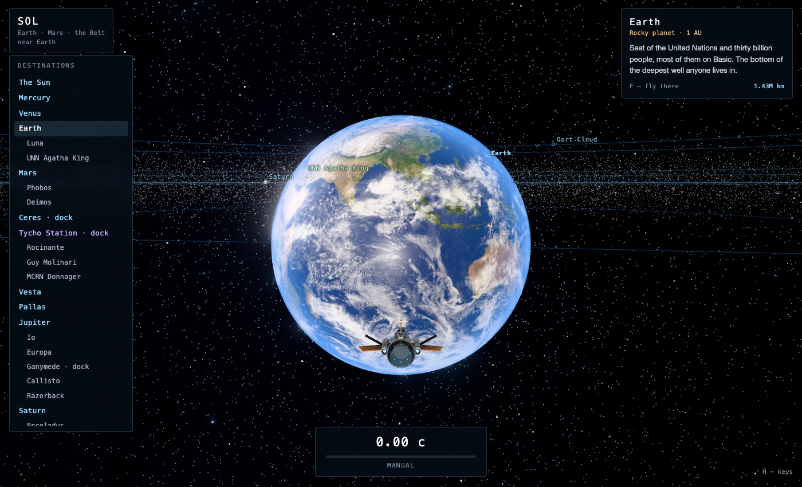

> **Unofficial and non-commercial.** *The Expanse* is the creation of James S. A. Corey (Daniel Abraham and Ty Franck). This project is a tribute by a fan. It is not affiliated with or endorsed by the authors, their publishers or the makers of the television series, and it contains no footage, artwork, audio or text from them. See [CREDITS.md](CREDITS.md).

## What is in it

- **Sol at true scale**, sizes as well as distances: the Sun, the planets and their main moons, Ceres, the Belt, and the Ring out past Uranus. Most of space is empty, so use the destination list to get about. The real bodies use photographic maps from NASA missions.
- **Traffic**: several hundred ships fly routes between the ports, burning out, flipping at the half-way point and burning to a stop. From far off each is only a glint.
- **The ring space**, with Medina Station, the Ring Station and all 1,373 gates.
- **Systems beyond the gates**: Ilus, Laconia, Adro, Tecoma and a generated system for every other gate.
- **Ships to visit**: the Rocinante, the Donnager, the Canterbury, the Agatha King, the Razorback, the Guy Molinari, the Anubis and more.
- **Four places to dock and explore on foot**: Tycho Station, Ceres Station, Medina Station's drum and an agricultural dome on Ganymede. Ceres has neon-lit tunnels and the Concourse, a daylit street of terraced housing under a vaulted ceiling.

| | |
|---|---|
| 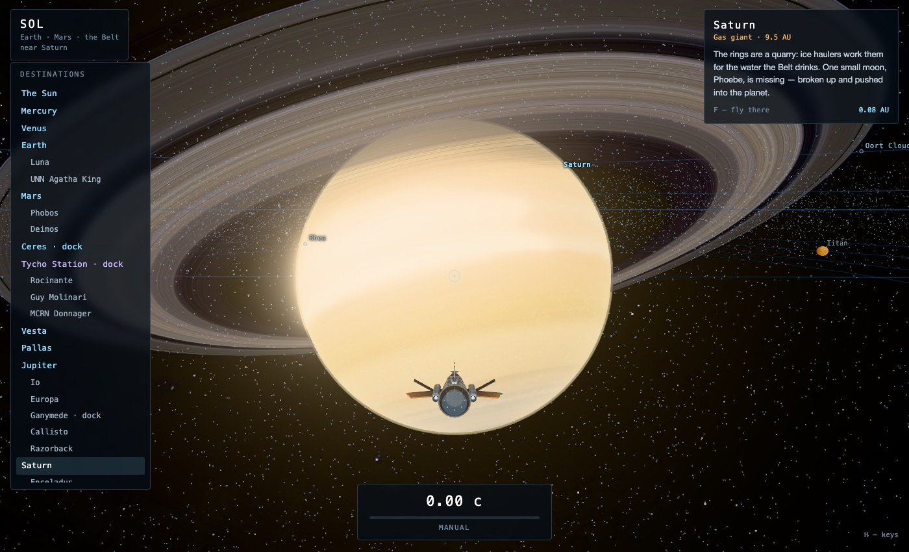 | 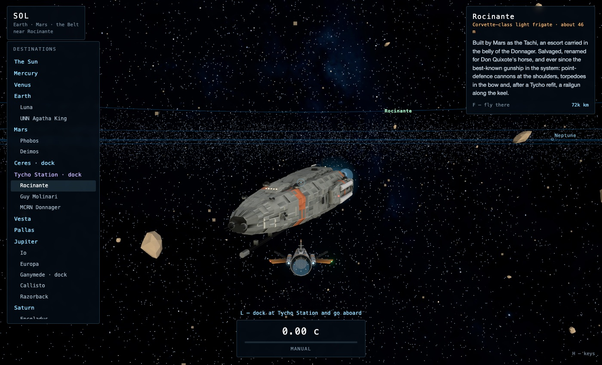 |
| 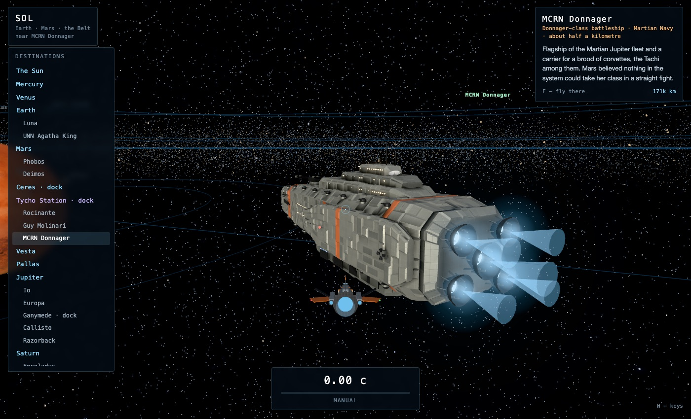 | 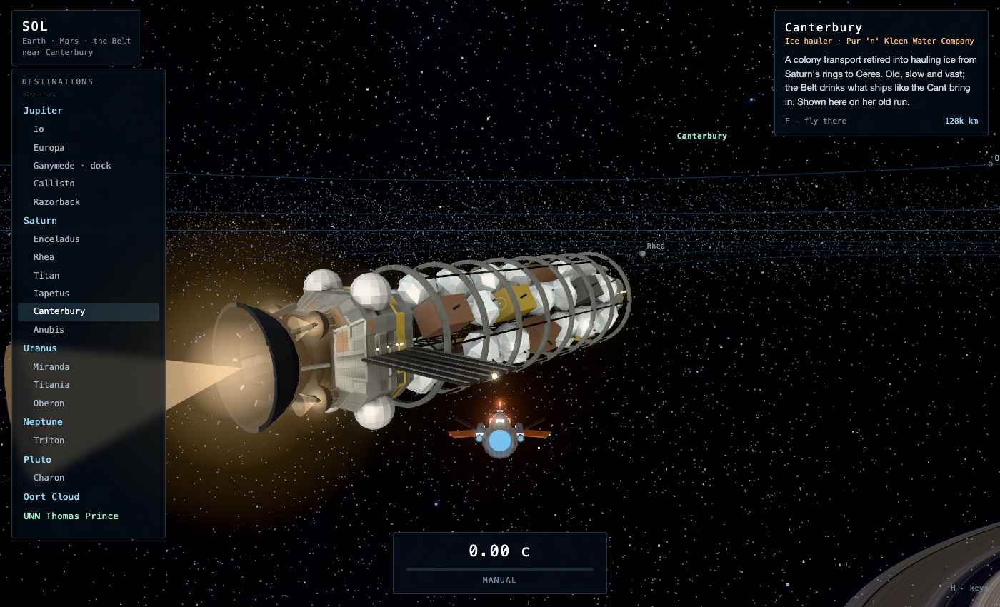 |
| 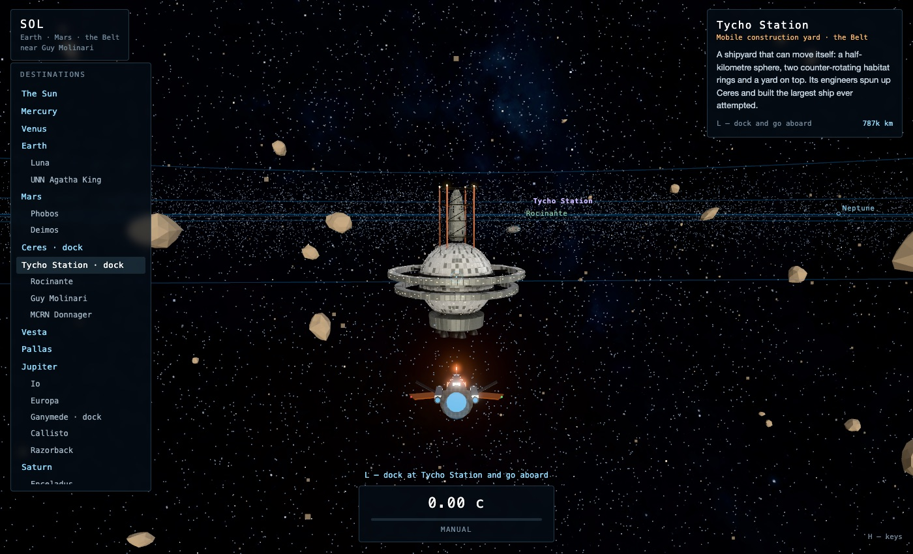 | 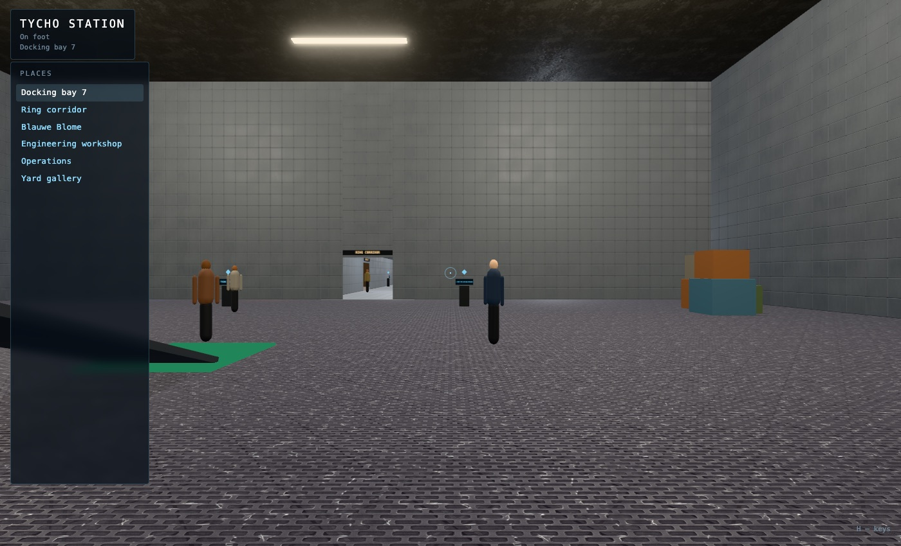 |
| 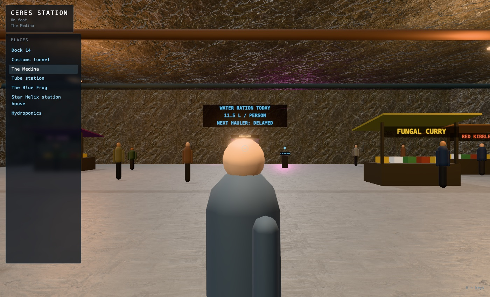 | 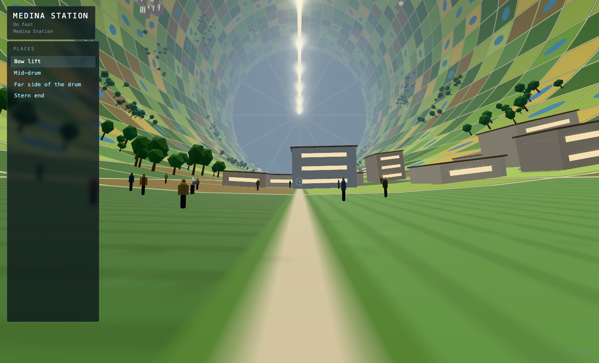 |
| 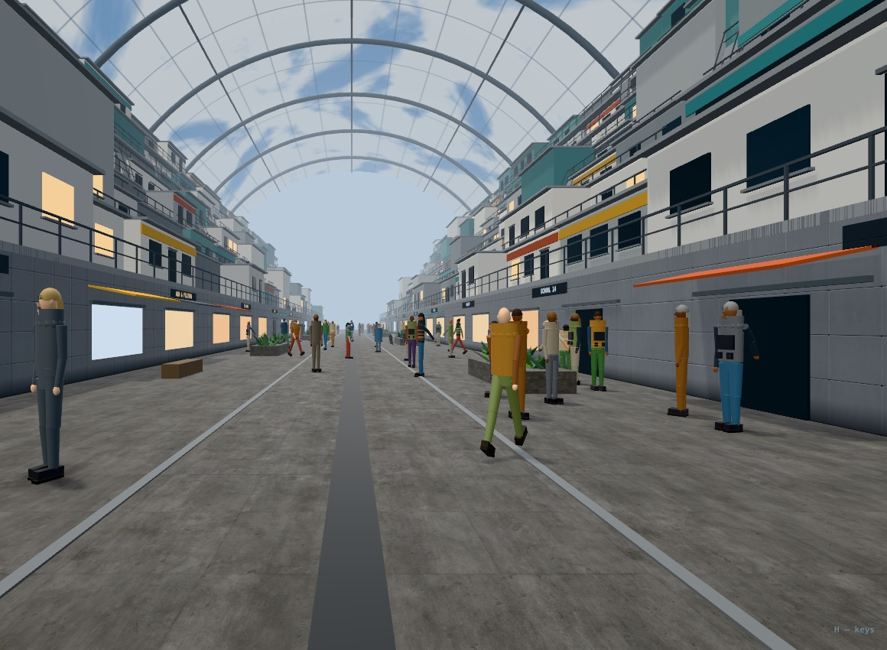 | 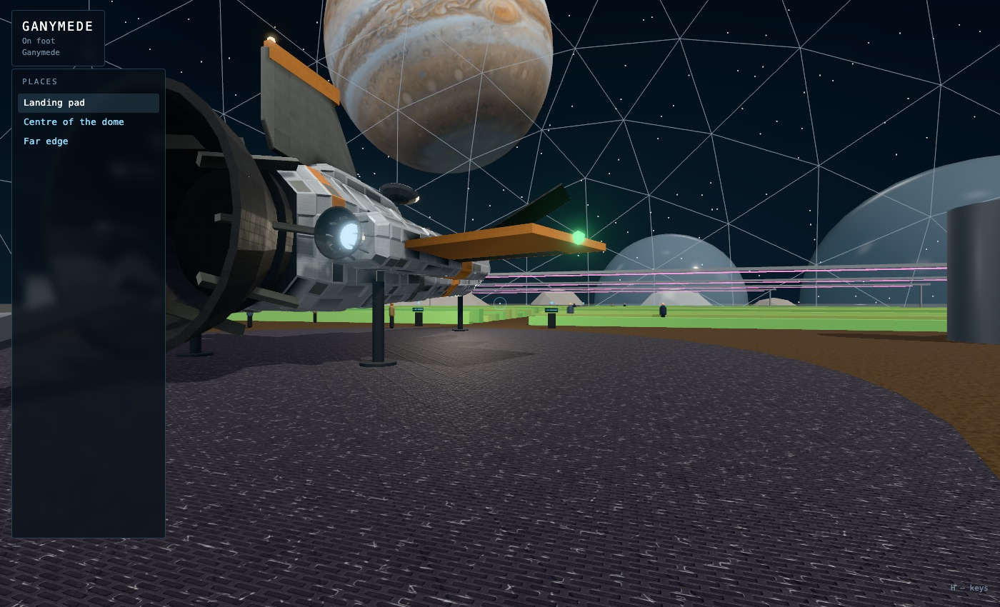 |

## Running it

You need [Bun](https://bun.sh).

```sh
bun install
bun run dev
```

Then open http://localhost:5180/.

Add `#slow` to the address to start in the ring space, or `#sys:77` to start in the system behind gate 77.

## Controls

**Flying**

| Key | Action |
|---|---|
| Mouse | Steer (click the view first) |
| W / S | Throttle up / down |
| X | Cut throttle |
| A D / arrows | Turn |
| Q / E | Roll |
| F | Fly to whatever is under the crosshair |
| G | Fly to the nearest ring |
| Tab | Destination list |
| L | Dock at a station and go aboard |
| V | Cockpit / chase view |
| O | Orbit lines |
| H | Show keys |

To jump, fly through the middle of a ring.

**On foot**

| Key | Action |
|---|---|
| Mouse | Look |
| W A S D | Walk |
| Shift | Run |
| Tab | Jump to a place |
| E | Board your ship (at the ship, or the lift on Medina) |

## How it is built

- TypeScript and [three.js](https://threejs.org), with no framework. `src/main.ts` holds flight, docking, walking and the display.
- `src/data.ts` describes Sol by hand and generates every other system from its gate number.
- `src/photos.ts` and `assets/tex` hold the photographic planet maps; `src/textures.ts` paints every other world in code.
- `src/interior.ts` is a small kit of rooms, props and people, and the four interiors made from it. `src/concourse.ts` builds the Ceres street and `src/people.ts` the crowd. `src/wear.ts` and `src/dressing.ts` add the grime, clutter, railings, signs and strings of lights, as a few merged meshes per room.
- `src/traffic.ts` flies the ships on their routes.
- The ship and station models are built by script in [Blender](https://www.blender.org). To rebuild them:

  ```sh
  blender -b -P tools/blender/hulltex.py          # the hull and window textures all ships share
  blender -b -P tools/blender/build.py -- all     # the models (add --preview <folder> for stills)
  ```

  The build weathers each model (dirt, soot, scuffed plate edges, held in vertex colours) and packs it with meshopt through `bunx`, so it needs a network connection the first time.

Everything is its true size: a ship is tens or hundreds of metres long in a system billions of kilometres across. Ships from different points in the story are all on show at once.

What comes next is in [docs/ROADMAP.md](docs/ROADMAP.md).

## Accuracy

The descriptions and ship designs were made from memory of the books and series, not checked against a reference. Expect differences from the canon. Corrections are welcome.

## Credits and licence

Full credits, with the licence of every third-party asset, are in [CREDITS.md](CREDITS.md). In short:

- Planet maps: Solar System Scope (CC BY 4.0), NASA, USGS and JPL (public domain), and Askaniy Anpilogov and others via Wikimedia Commons (CC BY-SA 3.0).
- Surface materials: ambientCG (CC0).
- The project's own code and models: MIT, see [LICENSE](LICENSE).
- *The Expanse* belongs to its owners. Nothing here grants rights in it.

Made with [Claude Code](https://claude.com/claude-code).
