# WebGPU go/no-go spike

Date: 2026-11-20. Branch: `webgpu-spike` (from main `50aeb51`). three.js r187.
This is the spike defined in [ROADMAP.md](ROADMAP.md) section 1. Nothing here is merged and the game's own code is untouched; the spike lives in `spike/`.

## The short answer

- **Depth: passes.** The Rocinante (46 m) drawn 20 m from the camera beside Earth and the Sun, at true scale, has **zero wrong pixels** on `WebGPURenderer` with reversed-Z. It also passes on the renderer's WebGL 2 fallback.
- **The roadmap gate: passes** on the letter (depth, plus condition (a), frame rate at least as good on both paths).
- **But the speed gain is not really WebGPU's.** Almost all of it comes from swapping the game's logarithmic depth for reversed-Z, and the classic `WebGLRenderer` can do that today. In the Tycho dock that swap alone took a frame from 14.1 ms to 4.7 ms.
- **Recommendation: do not migrate yet.** Move the existing WebGL game to reversed-Z first (about a day, and it is also step one of any later migration). A full migration with nothing lost is about 6 to 9 working days, mostly the light probes and the lens passes, and what it buys today is small. Reconsider when compute crowds or screen-space lighting are actually wanted.

## What was built

One page, `spike/webgpu.html`, that runs the same scene on three renderers chosen in the address bar:

| `?r=` | Renderer |
|---|---|
| `webgpu` | `WebGPURenderer` on WebGPU |
| `webgl2` | `WebGPURenderer` on its WebGL 2 fallback |
| `classic` | The game's `WebGLRenderer` with its scaled logarithmic depth (the reference). Add `&depth=reversed` for the classic renderer with reversed-Z instead. |

Files:

- `spike/world.ts`: the true-scale test scene. 1 unit = 1/1000 AU, as in the game. Sun at the origin, Earth one AU out with its cloud deck (76 km up) and storm cells (13 km above the clouds), Luna, and the game's own `corvette.glb` scaled to 46 m. Camera near plane 1e-9, far plane 4e6. Three camera stops: 20 m from the ship, 5 km from the ship, and low Earth orbit (400 km up, at sunrise).
- `spike/tsl.ts`: the TSL ports (see "Shader porting" below).
- `spike/glsl.ts`: copies of the game's atmosphere and night-lights GLSL, for the classic side.
- `spike/webgpu.ts`: the page: picks the renderer, runs the depth check or the benchmark.

The benchmark scenes use the game's real builders (`buildInterior('tycho')`, `buildInterior('medina')`, `loadModels`, `loadPeople`), not stand-ins.

## 1. Depth

### How it was checked

Looking at a picture is not enough, so the page measures it. With `view=check` the scene is drawn twice in flat colours (one colour per body, surface directions on the ship):

1. normally, trusting the depth buffer;
2. in an order worked out by hand: Sun, Luna, Earth, clouds, storm cells painted far to near with the depth test off, then the ship drawn on top with a second camera whose near and far planes hug the hull (ordinary depth is exact over so short a range).

Any pixel that differs is a depth mistake. The page counts them and paints them red. 1,400 × 800 pixels, no antialiasing.

### Results (Chrome 159, Apple M5, headless)

Wrong pixels out of 1,120,000:

| Renderer and depth method | 20 m | 5 km | Low orbit |
|---|---|---|---|
| Classic WebGL, the game's log depth (reference) | 0 | 0 | 0 |
| Classic WebGL, reversed-Z with a float depth target | 0 | 0 | 0 |
| **WebGPU, reversed-Z** (`reversedDepthBuffer: true`) | **0** | **0** | **0** |
| WebGPU, reversed-Z, world slid to put the camera at the origin | 0 | 0 | 0 |
| WebGPU, the game's scaled log depth rewritten in TSL | 0 | 0 | 0 |
| WebGL 2 fallback, reversed-Z | 0 | 0 | 0 |
| WebGL 2 fallback, scaled log depth in TSL | 0 | not run | not run |
| WebGPU, three's stock `logarithmicDepthBuffer` | fails (see below) | 0 | not measurable (ship at 20 m again) |
| WebGPU, plain depth | 63,312 | 78,484 | 830 |

The 20 m results for WebGPU reversed-Z, the TSL log depth and the fallback were repeated on Chromium 131 (the older build Playwright 1.49 ships): all 0.

WebGPU, reversed-Z, 20 m from the hull, against today's game renderer:

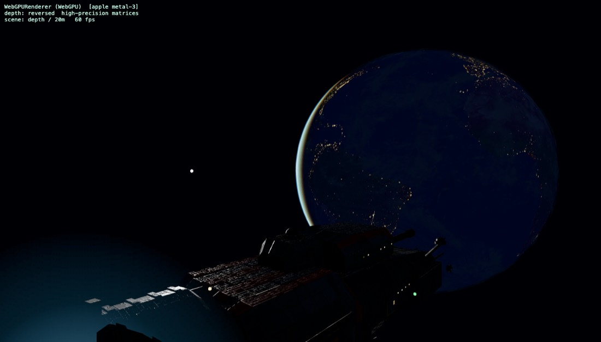
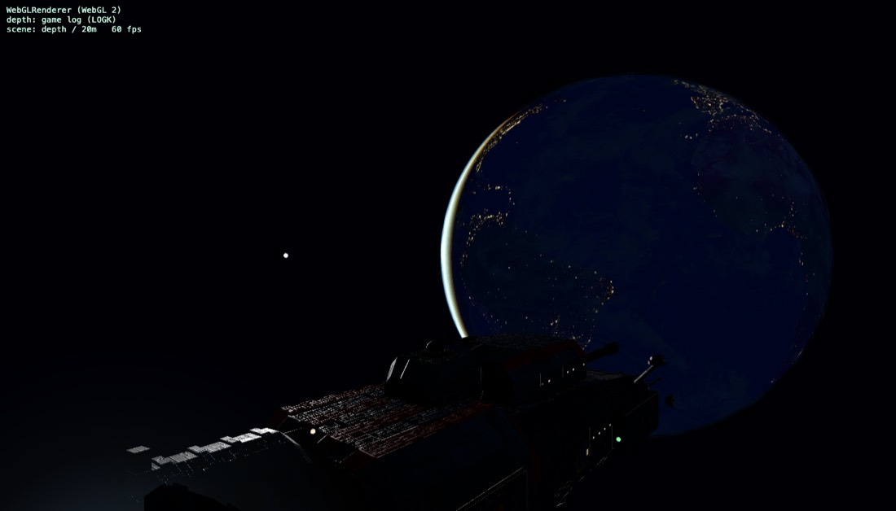

The check itself (dimmed flat colours; a wrong pixel would be red):

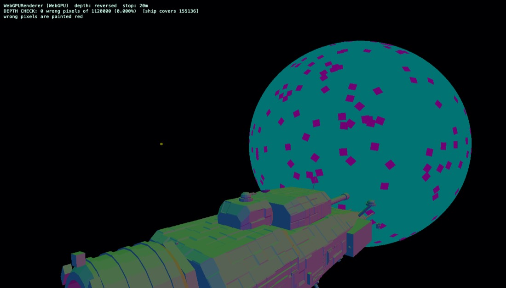

What failure looks like, for comparison. Plain depth cannot order anything at planet distance:

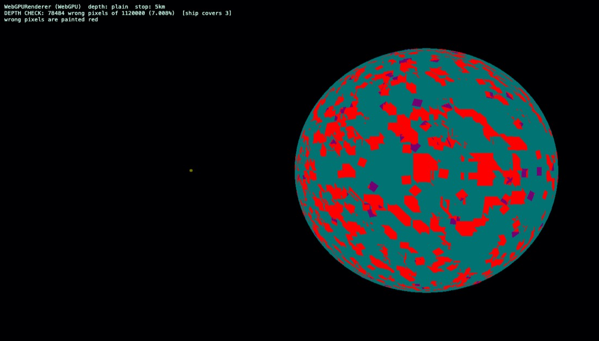

### What was learned

1. **Reversed-Z is the answer.** WebGPU gives it a 32-bit float depth buffer, and the result is as good as the game's log depth with no shader work at all. The far plane no longer needs the `* LOGK` scaling.
2. **three's stock logarithmic depth does not work at this scale.** It clamps the near plane to 0.000001 units, which here is 150 m. Everything nearer lands on depth zero and the hull is scrambled. The count in the table is blank because the check's own reference pass suffers the same clamp, so it cannot see the fault; the picture can:

   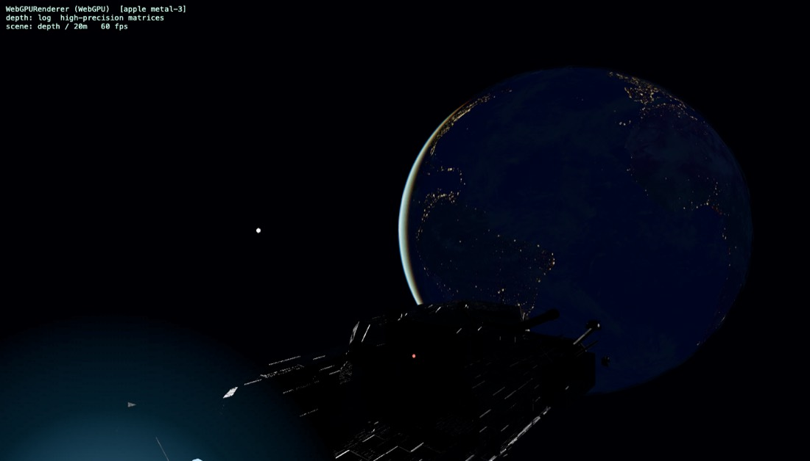

3. **The game's own log depth ports to TSL in three lines** (`logDepth` in `spike/tsl.ts`) and is correct, but it writes depth per pixel, which switches off the graphics card's early depth test. It is the slower choice (see benchmarks). Keep it only as a fallback.
4. **A second, separate precision problem appeared, and it matters more than depth.** The game keeps the camera at its real position, about 1,000 units from the Sun, and relies on the classic renderer multiplying matrices in JavaScript's 64-bit numbers. `WebGPURenderer` does that multiplication on the graphics card in 32 bits by default, and the ship simply vanishes:

   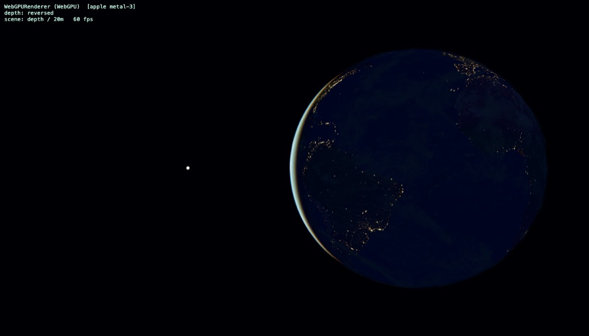

   Two fixes, both tested and both give 0 wrong pixels:
   - `renderer.highPrecision = true` (one line). three's documentation says this is "not compatible with InstancedMesh and SkinnedMesh". A quick test with sixty instanced rocks around the ship did draw correctly (`&inst=1`), but the game's belts, gate rings, storm cells and walking people would all need checking.
   - A floating origin: slide the world each frame so the camera sits at zero (`&float=1`). More work in the game (everything that reads `camera.position` in world units), but it has no caveats and is the standard cure.
5. The WebGL 2 fallback gets reversed-Z through the `EXT_clip_control` extension. Chrome has it. If a browser does not, the fallback drops to plain depth and true scale breaks; a migrated game would have to detect that and switch to the TSL log depth.

## 2. Shader porting

### Ported in the spike

All in `spike/tsl.ts`, each next to a note of where its GLSL lives.

| Site | Original | Port | Effort | Checked |
|---|---|---|---|---|
| Scaled log depth | `main.ts` `ShaderChunk` patch | `logDepth()`, or nothing at all with reversed-Z | minutes | Depth check, 0 wrong |
| Atmosphere | `main.ts` `ATMO_V`/`ATMO_F`, a `ShaderMaterial` with two nested loops | `atmosphere()` | about 1.5 hours | By eye against the GLSL at 20 m and low orbit: the limb matches |
| Night-side city lights | `main.ts` `nightOnly()`, an `onBeforeCompile` patch | `nightOnly()`, one line | minutes | By eye: matches |
| Ring gate film | `main.ts` `GATE_V`/`GATE_F` | `gateFilm()` | 15 minutes | **Written, not run** |
| Hologram adverts | `interior.ts` line 854 | `hologram()` | 15 minutes | Drawn in Tycho on WebGPU and the fallback |
| Bloom + tone mapping + film finish | `EffectComposer`, `UnrealBloomPass`, `OutputPass`, `look.ts` `FINISH` | `postChain()` | about 1 hour | Runs; look is close, not matched (see below) |

Useful discoveries:

- **`onBeforeCompile` sites port without replacing the material.** When `WebGPURenderer` turns a classic material into a node material it copies every property across, so setting `emissiveNode`, `depthNode` and the like on the existing `MeshStandardMaterial` just works. The string surgery disappears.
- **A `ShaderMaterial` is silently not drawn.** No error, nothing on screen. Every one must be replaced.
- **Plain materials need nothing.** The whole Tycho interior (1,217 draws, 2.2 million triangles, shadows, scanned PBR surfaces, signs, skinned people) drew on WebGPU first time with no changes other than the hologram swap:

  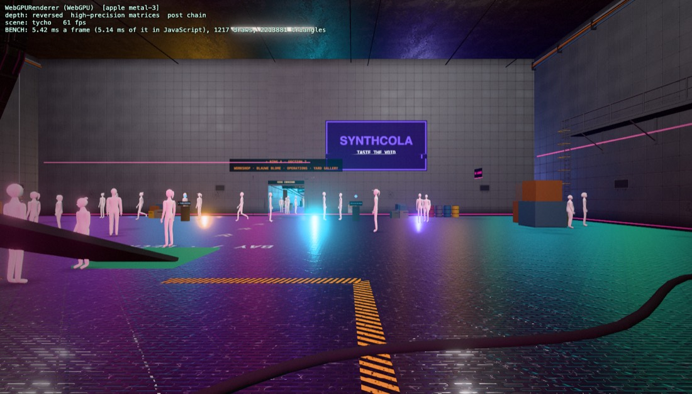
  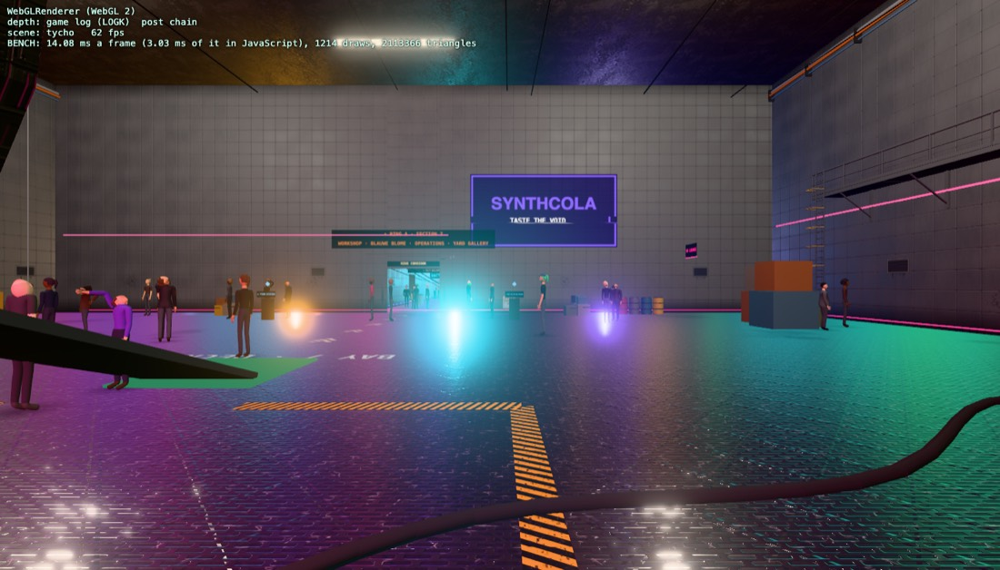

  The people are pink on WebGPU because their palette shader is one of the unported sites.
- Small traps: GLSL's `smoothstep` with its edges the wrong way round (the game uses it) is undefined in WGSL and has to be flipped; a WebGPU canvas forgets its picture as soon as the script pauses, so screenshots and photo mode must copy it in the same breath as the draw; and a post chain's scene pass only redraws once per "frame" as counted by the renderer's own timer.

### Not ported: estimates

| Site | What it needs | Estimate | Risk |
|---|---|---|---|
| Ring shadow (`main.ts`, `onBeforeCompile` on the ring's basic material) | A `colorNode` multiply from the local position | 30 minutes | Low |
| Person palette (`skinned.ts`, `onBeforeCompile` on a skinned standard material) | Palette colour and roughness by vertex part number are easy (`colorNode`, `roughnessNode`). The baked crease shade dims indirect and direct light by different amounts, which needs `aoNode` plus a small custom lighting step | half a day to a day | Medium |
| Light probes (`probes.ts`) | The biggest item. Showing them is a per-vertex lookup in a 3D texture added to the irradiance; in TSL that is a vertex function plus a custom lighting node. Taking them uses `LightProbeGridWebGL`, which is WebGL-only; three has a separate node version (`LightProbeGridNode`) that works differently. Either port the bake or keep the classic renderer just for `?bake` | 2 to 3 days | High |
| God rays (`look.ts` `RaysPass`) | A quarter-size pass fed by one of bloom's internal blur levels. `BloomNode` keeps those private, so either reach into it or run a small blur of our own; three also ships a `GodraysNode` that could replace it | half a day | Medium |
| Lens ghosts, dirt, starburst (`look.ts` `LENS`) | Same dependency on bloom's blurred image; otherwise a straight translation. three ships `LensflareNode` and `lensDirt` | half a day to a day | Medium |
| Lightning (`lightning.ts`) | No custom shader: an instanced basic material with per-instance colour. Should work as it is | check only | Low, untested |
| Stars, belt dust, traffic dots (`PointsMaterial`, fixed pixel size) | WebGPU has no wide points; three draws sized points as sprites. Needs a look | an hour or two | Medium, untested |

### The post chain

`EffectComposer` does not exist on WebGPU. The replacement is a `RenderPipeline` whose output is one node graph. The spike's `postChain()` does: scene pass (4× MSAA) → three's `BloomNode` (same strength, radius and threshold as the game) → `renderOutput` (tone mapping and colour space, the job of `OutputPass`) → the film finish (grade, vignette, grain) in TSL.

It works on both WebGPU and the fallback. Left to do: god rays and lens ghosts (above), the per-place grade easing, and tuning. The bloom is not a pixel match: at low orbit the classic chain lifts the whole sky slightly blue and the WebGPU chain does not.

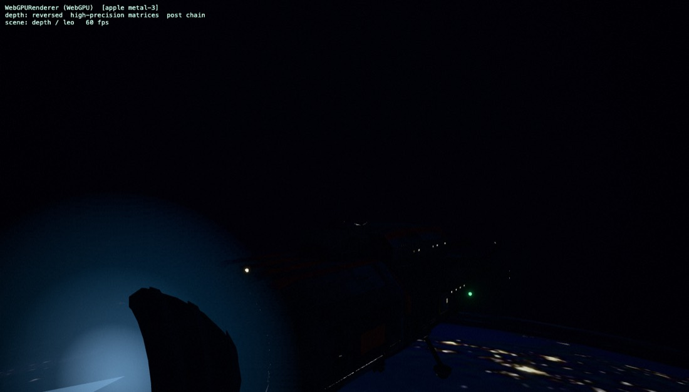
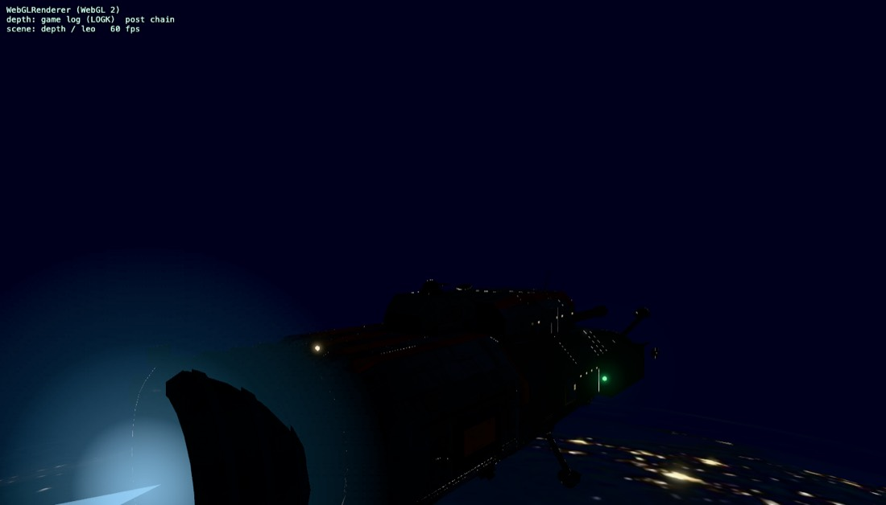

## 3. Benchmarks

Milliseconds to draw one frame, with the graphics card made to finish (so vsync is not in the way). Median of 15 runs of 20 frames. Chrome 159 headless, Apple M5. Bloom and tone mapping on in every column. "JS" is the part of the frame spent in JavaScript.

- **Sol**: the test scene at the 20 m stop plus 24 ships of every class within 30 km.
- **Sol, low orbit**: the same from 400 km up, the atmosphere filling much of the frame.
- **Tycho**: standing in "Docking bay 7".
- **Medina**: at the default size, the first place on its list; at Retina size, "Mid-drum".

At 1,400 × 800, one pixel per point:

| Scene | Game today (WebGL, log depth) | WebGL, reversed-Z | WebGPU, reversed-Z | WebGPU, log depth in TSL | WebGL 2 fallback, reversed-Z |
|---|---|---|---|---|---|
| Sol (855 draws, 0.6 M triangles) | 1.64 (JS 1.10) | 1.39 | 1.48 (JS 1.39) | 1.44 | 1.41 |
| Sol, low orbit (478 draws) | 1.53 | 1.23 | 0.98 | 1.03 | 0.99 |
| Tycho (1,214 draws, 2.1 M triangles) | **14.08** (JS 3.03) | **4.72** (JS 4.39) | 5.42 (JS 5.14) | 8.45 | 5.43 |
| Medina (360 draws, 0.4 M triangles) | 1.72 (JS 0.61) | 1.65 | 1.16 (JS 1.09) | 1.21 | 1.20 |

At 2,800 × 1,600 (Retina, two pixels per point):

| Scene | Game today | WebGL, reversed-Z | WebGPU, reversed-Z | WebGL 2 fallback, reversed-Z |
|---|---|---|---|---|
| Sol, low orbit | 4.97 | 4.00 | 1.57 | 2.70 |
| Tycho | 18.30 | 11.24 | 6.93 | 8.84 |
| Medina, mid-drum (128 draws) | 4.93 | 4.75 | 2.02 | 3.47 |

Without the post chain at Retina size, WebGPU against the game today: Sol low orbit 1.16 against 3.23, Tycho 6.30 against 13.85, Medina 1.60 against 1.77. The fallback lost one of these: Medina 2.99 against 1.77.

### What the numbers say

1. **The game's log depth is expensive indoors.** It writes depth for every pixel, so the card cannot skip hidden surfaces before shading them. Tycho goes from 14.1 ms to 4.7 ms on the *classic* renderer just by switching to reversed-Z. On WebGPU the same comparison is 8.5 ms against 5.4 ms.
2. **`WebGPURenderer` costs more JavaScript per draw, not less.** Tycho: 5.1 ms against 3.0 ms for the same draws. The roadmap's hoped-for "lower CPU draw-call cost" did not show up; at ordinary resolution the classic renderer with reversed-Z is the fastest thing measured in Tycho. For the 1,000-ship ambition this points the wrong way unless batching or compute is added on top.
3. **Where the frame is limited by pixels (Retina), WebGPU is clearly ahead**, about 1.6 to 2.5 times faster than the classic renderer with the same depth method. Some of this is the leaner node post chain, some is the backend.
4. Every figure here is far inside a 60 fps frame (16.7 ms) on this machine except the game's current Tycho at Retina size.

### Caveats

- Headless Chrome only. **Not run in Safari**, which is the only browser installed on this Mac, and not in a visible window.
- The WebGPU side draws slightly less than the game does: the people have no palette shader, and neither side has bounce light from the probes, god rays or lens ghosts.
- Frame cost, not frame rate: a real session adds the game's own per-frame work.

## 4. The gate

From the roadmap: *go only if the depth test passes and at least one of (a) frame rate is at least as good on both paths, (b) GTAO or SSGI visibly improves interiors, (c) compute crowds hit 1,000+ people at 60 fps.*

| Condition | Result |
|---|---|
| Depth test | **Pass.** 0 wrong pixels at all three stops, on WebGPU and on the fallback |
| (a) Frame rate at least as good on both paths | **Pass**, with a footnote. With the post chain on, WebGPU and its fallback were at least as fast as today's game in every scene measured. The footnote: most of the gain is the depth method, which WebGL can have too, and against WebGL-with-reversed-Z at ordinary resolution WebGPU is level or slightly behind |
| (b) GTAO or SSGI visibly improves interiors | **Not shown.** three's `GTAONode` runs with reversed-Z (`&ao=1`, about 1 ms extra in Tycho) but at default settings the difference in the dock is slight. It was not tuned, and SSGI was not tried |
| (c) Compute crowds | **Not attempted** |

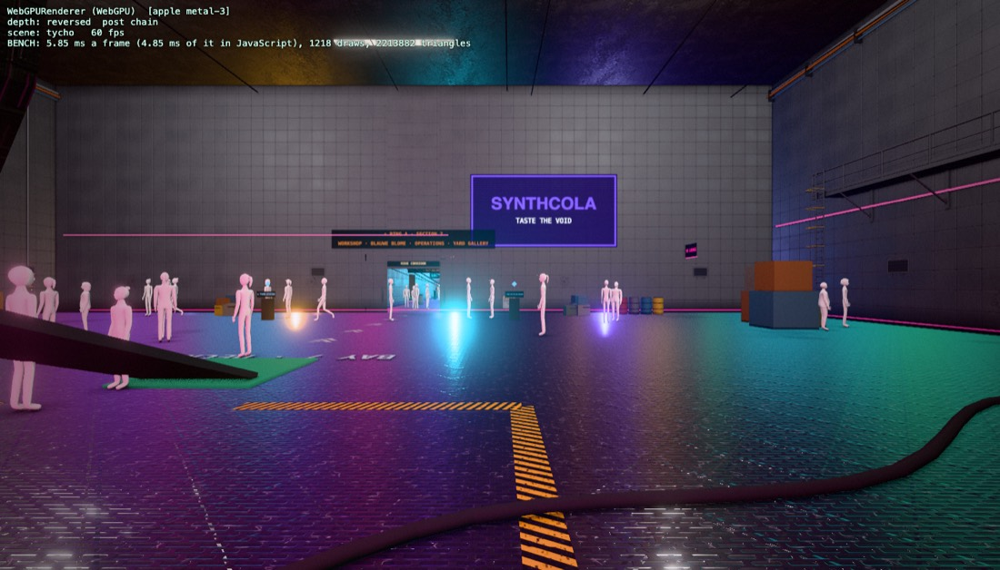

**So the gate says go.** The honest reading is narrower: the spike removed the biggest risk (depth works) and showed the migration is feasible, but it did not find a reason to do it now.

## 5. What a migration would cost

About **6 to 9 working days** for the game to look the same on `WebGPURenderer`:

| Work | Days |
|---|---|
| Reversed-Z everywhere: drop the `LOGK` patch and the `* LOGK` on every far plane, remove the log-depth includes from the custom shaders | 0.5 |
| World precision: `highPrecision` and a check of every instanced and skinned mesh, or a floating origin | 0.5 to 1.5 |
| Swap renderer, post chain with bloom and film finish, the already-ported shaders, ring shadow | 1 |
| God rays and lens ghosts | 1 to 1.5 |
| Person palette | 0.5 to 1 |
| Light probes: showing them, and either porting the bake or keeping WebGL for baking | 2 to 3 |
| Points, sprites (the drive glow came out brighter), shadows, environment map, photo mode, debug hooks, the Playwright scripts, a pass through every place | 1 to 1.5 |

Also to carry: three's node pipeline still changes between releases (pin the version), and the fallback needs `EXT_clip_control` or a second depth path.

## 6. Recommendation

1. **Do not migrate now.** The roadmap's own reasoning still holds: the limit on realism is content, and WebGPU's real prizes (compute crowds, screen-space lighting) are not needed yet.
2. **Do take the cheap win on WebGL: reversed-Z.** `new WebGLRenderer({ reversedDepthBuffer: true })` with a float `DepthTexture` on the composer's target gave 0 wrong pixels at true scale and cut Tycho from 14.1 ms to 4.7 ms a frame. A canvas cannot have float depth, so anything drawn straight to the screen (rather than through the composer) would need the same treatment. This needs its own check in the real game, including Safari, before it is believed.
3. **Come back to WebGPU when (b) or (c) is actually wanted.** The entry cost is now known, and step 2 is its first half-day already done.

## Running it yourself

```sh
git switch webgpu-spike
bun run spike        # serves http://localhost:5192/
```

Open `http://localhost:5192/` in Safari. The links at the top right load each combination; the top-left text says which renderer and backend is really running and, for the checks, the wrong-pixel count. The ones worth trying by hand, since Safari was not tested:

- `?r=webgpu&depth=reversed&hp=1&view=check&aa=0` should say 0 wrong pixels.
- `?r=webgpu&depth=reversed&hp=1&stop=leo&post=1` for the atmosphere and post chain.
- `?r=webgl2&depth=reversed&hp=1&view=check&aa=0` shows whether Safari's WebGL has the extension reversed-Z needs. If the top-left text says wrong pixels in the tens of thousands, it does not.
- `?r=webgpu&scene=tycho&post=1&bench=1` against `?r=classic&scene=tycho&post=1&bench=1` and `?r=classic&depth=reversed&scene=tycho&post=1&bench=1`.

### Headless testing

Headless WebGPU works on this Mac in Playwright's Chromium (131 and 159) with a real Apple GPU adapter and no special flags (`--use-angle=metal --enable-gpu --ignore-gpu-blocklist`, as the existing scripts use). Do **not** add `--enable-unsafe-webgpu`: on Chromium 131 it made three's adapter request come back empty and then lost the device. Playwright's WebKit (18.2) and Firefox (132) builds have no `navigator.gpu` headless, so automated checks would be Chromium-only.
